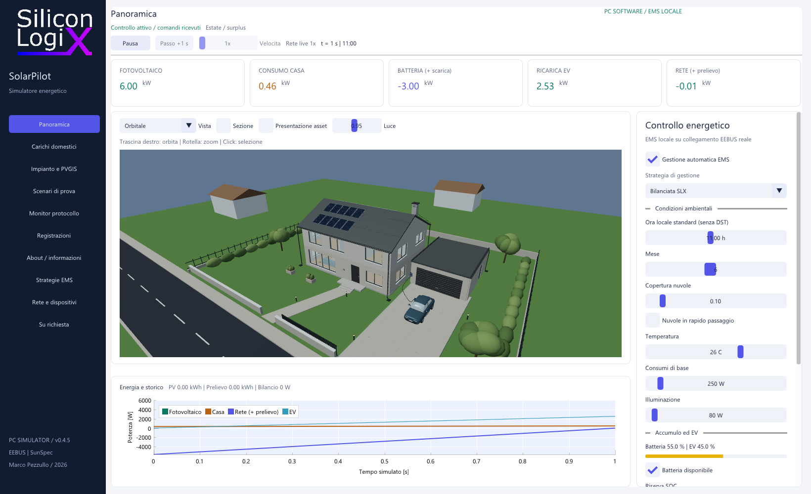

# SLX SolarPilot

Copyright (c) 2026 Marco Pezzullo — Silicon LogiX. Licenza: Silicon LogiX Evaluation License 1.0. Vedere LICENSE.

[](https://github.com/Silicon-Logix/slx-solarpilot/actions/workflows/validate.yml)
[](https://github.com/Silicon-Logix/slx-solarpilot/releases/tag/v0.4.5)

[**Scarica SolarPilot 0.4.5 per Windows**](https://github.com/Silicon-Logix/slx-solarpilot/releases/download/v0.4.5/SLX-SolarPilot-0.4.5-windows-x64.zip)
· [Note della versione](docs/RELEASE_NOTES_0.4.5.md)

Simulatore energetico residenziale **0.4.5 per Windows x64**, con abitazione 3D,
fotovoltaico, accumulo, carichi domestici e ricarica di veicoli elettrici.
L'interfaccia mostra flussi di potenza, consumi ed effetti dei comandi
sull'impianto simulato.





## Avvio

Avviare **SLX-SolarPilot.exe** oppure **Run-SLX-SolarPilot.cmd**. Sono richiesti
Windows 10/11 x64 e un driver grafico compatibile con OpenGL 3.3. Le cartelle
`assets`, `config` e `SLX_SolarPilot` devono rimanere accanto al programma.
La cartella `SLX_SolarPilot` contiene soltanto gli asset necessari al simulatore:
scena runtime, due varianti fotovoltaiche e relativi dati. Il progetto Blender,
gli export dei singoli oggetti e le anteprime di lavorazione sono esclusi.

- **Avvia** esegue la simulazione; **Pausa** e **Passo +1 s** consentono di esaminarla.
- Mouse destro per orbitare, rotella per lo zoom e click per selezionare un componente.
- **F1** apre la guida; **F12** apre le informazioni sul prodotto.

## Funzioni

- Abitazione 3D con pannelli solari, impianto ed elettrodomestici ispezionabili.
- Produzione fotovoltaica con variazioni di ora, mese, nuvole e temperatura.
- Accumulo con rendimento, riserva e limiti di carica e scarica.
- Ricarica EV e coordinamento dei carichi con strategie di autoconsumo.
- Scenari, confronto delle policy, registrazione, riproduzione e dati CSV.
- Monitor dei messaggi EEBUS e dei telegrammi SunSpec Modbus TCP.

I valori descrivono il modello simulato. Le opzioni contrassegnate **Su richiesta**
sono proposte di integrazione e non funzioni operative del programma distribuito.

## Collegamenti con dispositivi esterni

La pagina **Rete e dispositivi** permette di impostare indirizzi IP, porte e ruolo
del simulatore. EEBUS usa SHIP/SPINE con identità e associazione esplicita del
dispositivo; SunSpec Modbus TCP consente di esporre l'impianto o collegarsi a un
dispositivo remoto. Il monitor presenta i messaggi effettivamente scambiati.

L'interoperabilità dipende dai modelli e dai casi d'uso implementati dall'altro
dispositivo. La distribuzione non costituisce una certificazione EEBUS o SunSpec.
Vedere [Interoperabilità](docs/INTEROPERABILITY.md) e [Protocolli](docs/PROTOCOL.md).

## Interfaccia e SDK

Sono inclusi i sorgenti pubblici C++ dell'interfaccia, il renderer, l'host
asincrono, l'API C e la policy di esempio. Il core energetico e il servizio dei
protocolli sono forniti come binari. Uso e modifiche sono regolati dalla licenza.

Per compilare servono Python 3.11+, CMake 3.24+ e Ninja. Il primo avvio dello
script scarica e verifica le dipendenze e il compilatore portabile.

```powershell
powershell -ExecutionPolicy Bypass -File scripts/build-windows.ps1
```

Con una toolchain LLVM-MinGW UCRT già disponibile:

```powershell
powershell -ExecutionPolicy Bypass -File scripts/build-windows.ps1 -Toolchain C:/tools/llvm-mingw/bin
```

La compilazione produce GUI, CLI e verifiche sotto `build/ucrt`. La build pubblica
usa i binari forniti in `core/windows-x64` e non richiede i sorgenti del core.

```powershell
./slx-solarpilot-cli.exe --scenario 2 --seconds 7200 --csv nuvole.csv --record nuvole.slxrun
ctest --test-dir build/ucrt --output-on-failure
```

## Documentazione

- [Modello energetico e scenari](docs/MODEL.md)
- [Strategie EMS](docs/EMS.md)
- [API e SDK](docs/API.md)
- [Architettura](docs/ARCHITECTURE.md)
- [Verifiche ripetibili](docs/VALIDATION.md)

Configurazioni e identità di connessione vengono create localmente durante
l'uso e non fanno parte della distribuzione.

## Licenze e contatti

Autore: **Marco Pezzullo — Silicon LogiX**. Copyright (c) 2026.
La licenza SLX copre il software e gli asset originali; i componenti di terzi
mantengono le rispettive licenze e attribuzioni. Vedere [LICENSE](LICENSE),
[THIRD_PARTY_NOTICES.md](THIRD_PARTY_NOTICES.md) e [FILE-LICENSES.json](FILE-LICENSES.json).

Sviluppi e integrazioni su richiesta: [siliconlogix.it](https://www.siliconlogix.it).
