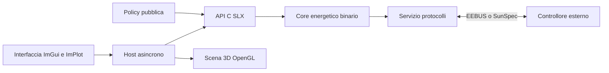

# Architettura

Copyright (c) 2026 Marco Pezzullo — Silicon LogiX. Licenza: Silicon LogiX Evaluation License 1.0. Vedere LICENSE.

SLX SolarPilot comprende un'interfaccia desktop C++20, un host asincrono,
un renderer OpenGL e un'API C con ABI stabile.

Il thread grafico possiede il contesto OpenGL. L'host serializza le richieste
al core in un thread dedicato e pubblica copie dello stato confermato, mantenendo
responsiva l'interfaccia durante le comunicazioni.

Il core e il bridge sono forniti come binari. Il confine C evita il trasferimento
di oggetti STL, eccezioni o allocazioni da liberare con un runtime diverso.
La policy di esempio usa strutture C con dimensione e versione esplicite.

Il renderer carica geometrie e texture una sola volta e conserva gerarchie,
materiali e articolazioni glTF. Sezioni e ispezioni degli elettrodomestici sono
geometriche; la disponibilità elettrica è gestita dal modello energetico.

La simulazione usa un passo fisso di un secondo. La velocità modifica quanti
passi vengono eseguiti, senza modificare il passo fisico. Rendering e timeout
di rete usano orologi distinti. Il collegamento EEBUS live procede a 1x.

Il profilo `config/visuals.json` definisce palette e separazione delle superfici
sovrapposte. Le correzioni sono applicate alle geometrie di presentazione senza
modificare i riferimenti elettrici dei componenti.

La compilazione pubblica importa la DLL e il servizio protocolli già forniti.
Le dipendenze grafiche sono scaricate con versioni e checksum fissati.
